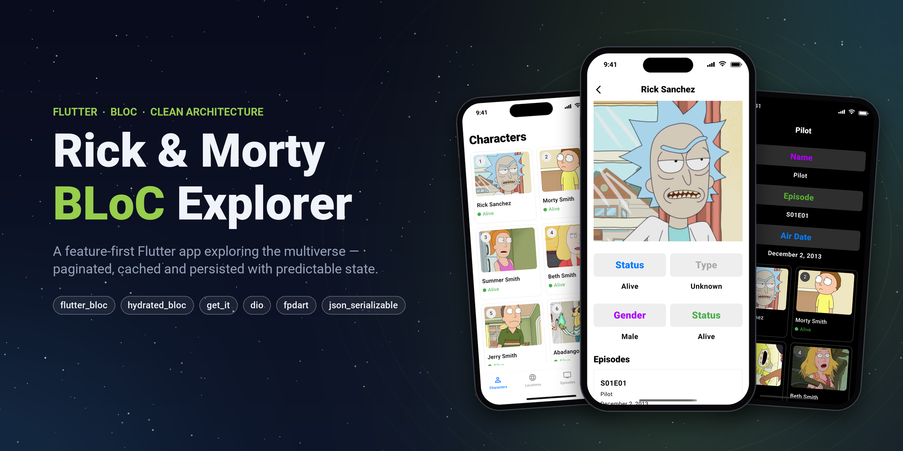
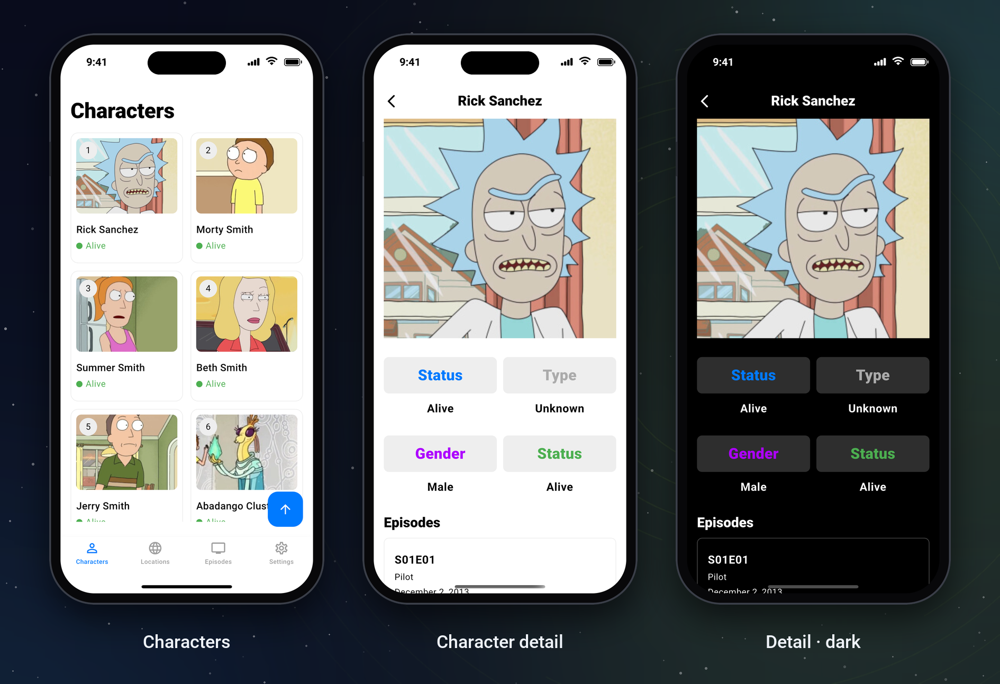
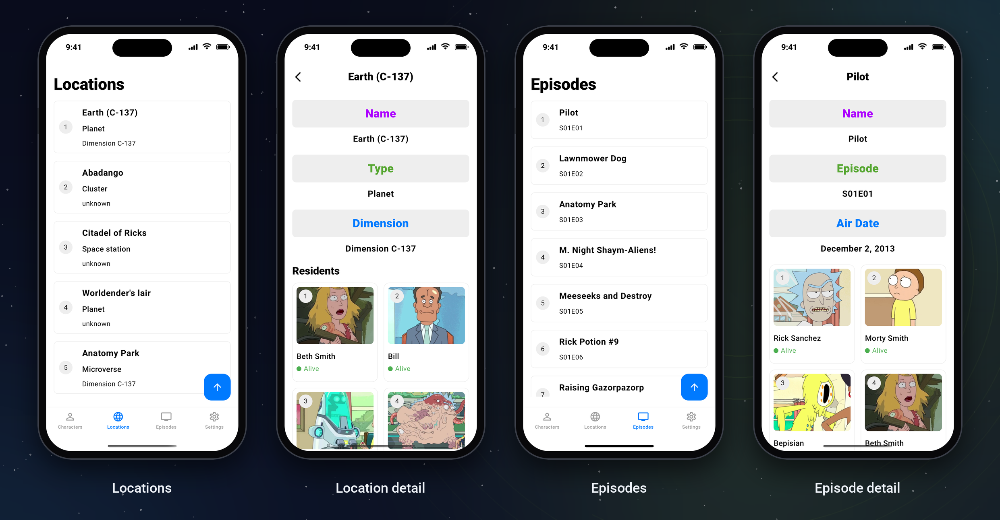
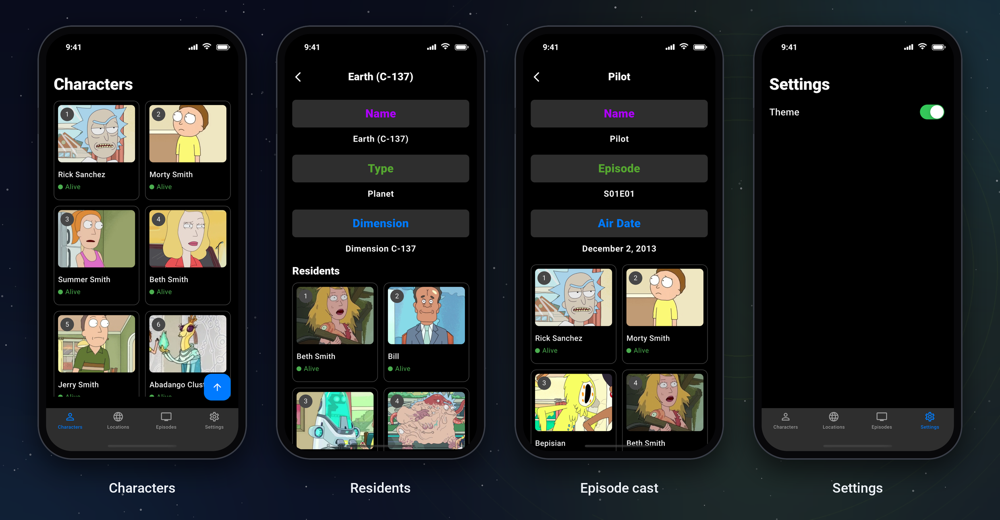
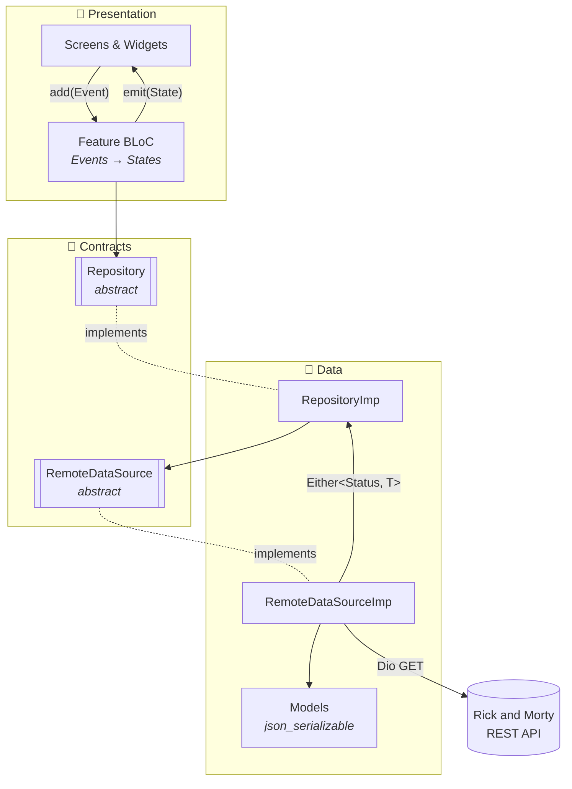
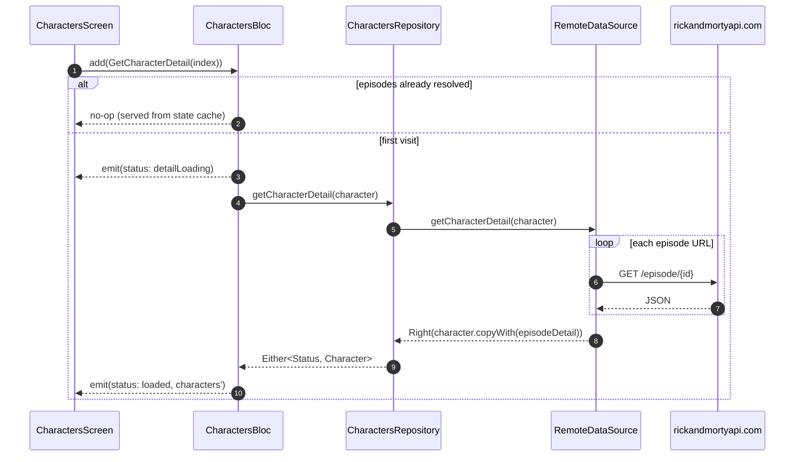
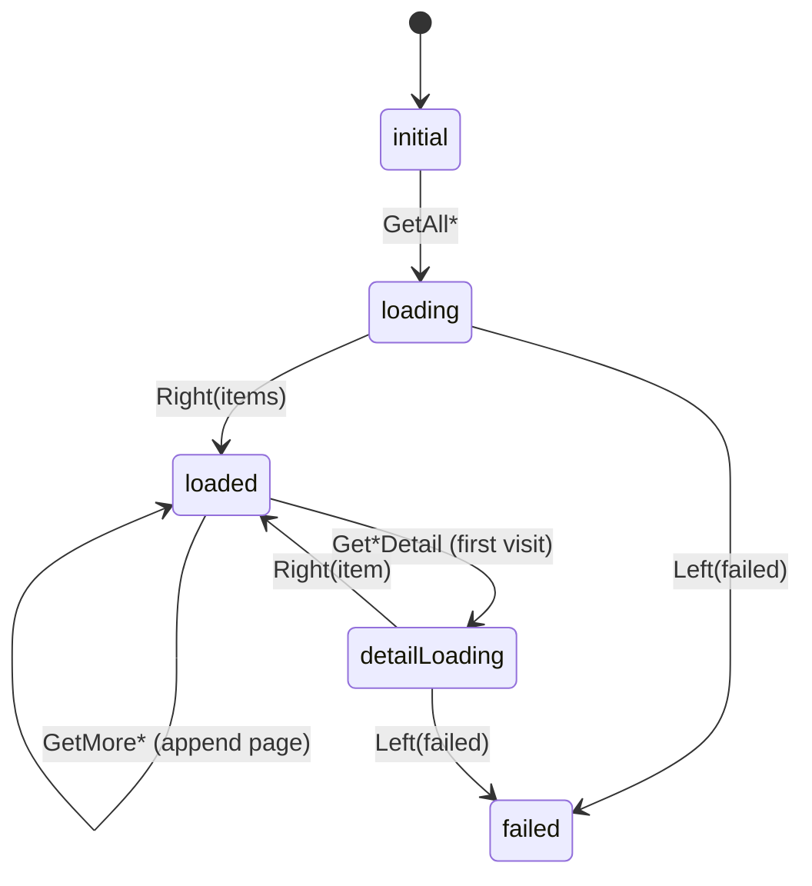

<div align="center">



<br />

# Rick & Morty — BLoC Explorer

**A production-style Flutter client for the [Rick and Morty API](https://rickandmortyapi.com), built to demonstrate scalable state management, feature-first architecture and clean separation of concerns.**

<br />

[](https://flutter.dev)
[](https://dart.dev)
[](https://bloclibrary.dev)
[](#-getting-started)

[Features](#-features) ·
[Screenshots](#-screenshots) ·
[Architecture](#-architecture) ·
[Design Decisions](#-key-engineering-decisions) ·
[Tech Stack](#-tech-stack) ·
[Getting Started](#-getting-started) ·
[Roadmap](#-roadmap)

</div>

---

## 📖 Overview

Rick & Morty BLoC Explorer lets you browse **826 characters, 126 locations and 51 episodes** from the Rick and Morty multiverse, with infinite scroll, rich detail screens that cross-link related entities, and a light/dark theme that persists across launches.

Beyond the UI, this project is a **reference implementation** of how I structure Flutter apps that need to scale past a handful of screens:

- **Feature-first modules**, each owning its full vertical slice: `bloc → repository → data source → model → UI`.
- **Unidirectional data flow** with `flutter_bloc`, where every UI state is an explicit, immutable, `Equatable` value.
- **Errors as values** using `fpdart`'s `Either` instead of exceptions leaking across layers.
- **Dependency inversion** with abstract repository and data-source contracts, wired through a `get_it` composition root.
- **State that survives**: bloc instances outlive tab switches, scroll positions are preserved, and user preferences persist to disk via `hydrated_bloc`.

---

## ✨ Features

<table>
<tr>
<td width="50%" valign="top">

### 🧬 Characters
- 2-column **infinitely scrolling grid** covering all 42 API pages
- Colour-coded **life-status indicator** (Alive / Dead / unknown), derived on the model
- **Character detail** with species, gender and type, plus every **episode they appear in**, resolved from raw API URLs into full objects

</td>
<td width="50%" valign="top">

### 🪐 Locations
- Paginated list of planets, space stations, microverses and more
- **Location detail** with type and dimension, plus a grid of **every resident**, each resolved into a full character card

</td>
</tr>
<tr>
<td width="50%" valign="top">

### 📺 Episodes
- Full episode guide with season/episode codes (`S01E01`)
- **Episode detail** with air date and the **full cast** that appeared in it

</td>
<td width="50%" valign="top">

### ⚙️ Settings & UX
- **Light/Dark theme** toggle, **persisted to disk** with `HydratedCubit`
- **Scroll-to-top** floating action button on every list
- **Lottie** loading animation and a dedicated failure state
- Scroll position and loaded data **survive tab switches**

</td>
</tr>
</table>

---

## 📱 Screenshots

### Core flow: Characters → Character detail



> Tapping a character dispatches `GetCharacterDetail`. The bloc lazily resolves the episode URLs into full `Episode` models **once**, caches them in state and renders them immediately on later visits.

### Exploring the multiverse: Locations & Episodes



### Dark mode, persisted across launches



---

## 🏛 Architecture

The app follows a **feature-first, layered architecture**. Each feature is a self-contained vertical slice, and shared concerns (theme, design tokens, reusable widgets, app-wide cubit) live in `core/`.



### Data flow: loading a character's detail



### State machine

Every feature bloc exposes the same explicit status lifecycle. `detailLoading` is kept **separate from** `loading` on purpose: the list screen keeps rendering its data while a detail request is in flight, instead of flashing a full-screen loader.



### Project structure

```text
lib/
├── main.dart                         # Bootstrap: DI, HydratedStorage, root BlocProvider
├── main_screen.dart                  # App shell with bottom navigation (driven by MainCubit)
├── injection_container.dart          # Composition root (get_it)
│
├── core/
│   ├── cubits/main/                  # MainCubit (HydratedCubit): tab index + persisted theme
│   └── utils/
│       ├── config/theme/             # Light & dark ThemeData
│       ├── constants/                # Design tokens: colors, sizes, paddings, icons, texts, urls
│       └── widgets/                  # Reusable UI: app bar, header, loading, failure, FAB, boxes
│
└── features/
    ├── characters/
    │   ├── bloc/                     # CharactersBloc · sealed events · Equatable state
    │   ├── data_sources/             # Abstract contract + Dio implementation
    │   ├── models/                   # Character (+ generated .g.dart)
    │   ├── repositories/             # Abstract contract + implementation
    │   ├── screens/                  # List & detail screens
    │   └── widgets/                  # Feature-specific card
    ├── episodes/                     # Same vertical slice
    ├── locations/                    # Same vertical slice
    └── settings/                     # Theme toggle
```

---

## 🧠 Key Engineering Decisions

<details open>
<summary><b>1. Feature-first over layer-first</b></summary>

<br />

Code is grouped by **what it does** (`characters/`, `episodes/`) rather than **what it is** (`blocs/`, `repositories/`). A feature can be understood, changed, tested or deleted without touching the rest of the codebase, which keeps cognitive load flat as the app grows and lets several developers own features in parallel without merge friction.

</details>

<details open>
<summary><b>2. Errors as values with <code>Either&lt;Status, T&gt;</code></b></summary>

<br />

Data sources catch transport failures at the boundary and return `Either` from `fpdart`, so no `try/catch` leaks into the bloc. The bloc **must** handle both branches through `fold`, which means the compiler, not convention, guarantees that every failure path is handled.

```dart
final result = await repository.getAllCharacters(pageIndex: currentPage);
result.fold(
  (failure)    => emit(state.copyWith(status: CharactersStatus.failed)),
  (characters) => emit(state.copyWith(status: CharactersStatus.loaded, characters: characters)),
);
```

</details>

<details open>
<summary><b>3. Programming to abstractions</b></summary>

<br />

Blocs depend on `CharactersRepository`, not `CharactersRepositoryImp`, and repositories depend on `CharactersRemoteDataSource`, not the Dio implementation. Adding a local cache (Hive, Isar, Drift), swapping the HTTP client or injecting test fakes is a **one-line change in the composition root**, with no feature code touched (Dependency Inversion & Open/Closed principles).

</details>

<details open>
<summary><b>4. Bloc lifetime decoupled from widget lifetime</b></summary>

<br />

Feature blocs are registered as **lazy singletons** in `get_it` and exposed to the tree with `BlocProvider.value`. Switching tabs therefore doesn't dispose the bloc, re-fetch page 1 or lose loaded data, and a `PageStorageKey` on each scrollable restores the exact scroll offset. The result is native-feeling tab navigation with zero redundant network calls.

</details>

<details open>
<summary><b>5. Lazy, memoised detail hydration</b></summary>

<br />

The list endpoints return related entities only as **URLs** (`character.episode: List<String>`). Instead of resolving them eagerly for hundreds of list items, the detail data is fetched **on first open** and written back into the model via an immutable `copyWith(episodeDetail: ...)`. Derived fields are excluded from deserialisation with `@JsonKey(includeFromJson: false)`, so the generated serializer stays faithful to the API contract.

</details>

<details open>
<summary><b>6. Selective persistence with <code>HydratedCubit</code></b></summary>

<br />

`MainCubit` owns both the bottom-nav index and the theme, but `toJson` serialises **only the theme**. User preferences survive restarts, while ephemeral navigation state deliberately resets to the home tab. Persistence is a conscious per-field decision, not a side effect.

</details>

<details open>
<summary><b>7. Modern, type-safe Dart</b></summary>

<br />

- **`sealed` event hierarchies** (Dart 3) make event handling exhaustive.
- **`Equatable` states** mean `BlocBuilder` only rebuilds when data actually changes.
- **Code-generated JSON** (`json_serializable` + `build_runner`) removes hand-written parsing and the runtime typos that come with it.
- **Immutable models** with `copyWith` throughout.

</details>

<details open>
<summary><b>8. A design-token layer</b></summary>

<br />

All visual constants are centralised in `core/utils/constants`: `RMColors`, `RMSizes`, `RMPaddings`, `RMIcons`, `RMTexts` and `RMUrls`. There are no magic numbers or inline strings in widgets, so the UI stays consistent and a re-brand or localisation pass touches one place.

</details>

---

## 🧰 Tech Stack

| Concern | Package | Why |
| --- | --- | --- |
| State management | [`flutter_bloc`](https://pub.dev/packages/flutter_bloc) | Predictable, testable event → state flow with a clear separation from UI |
| State persistence | [`hydrated_bloc`](https://pub.dev/packages/hydrated_bloc) | Declarative, per-field persistence of cubit state to disk |
| Dependency injection | [`get_it`](https://pub.dev/packages/get_it) | Lightweight service locator and a single composition root |
| Networking | [`dio`](https://pub.dev/packages/dio) | Robust HTTP client with interceptors, timeouts and typed responses |
| Functional error handling | [`fpdart`](https://pub.dev/packages/fpdart) | `Either` for explicit, compiler-enforced failure handling |
| Value equality | [`equatable`](https://pub.dev/packages/equatable) | Cheap state comparisons that prevent unnecessary rebuilds |
| Serialisation | [`json_serializable`](https://pub.dev/packages/json_serializable) + [`build_runner`](https://pub.dev/packages/build_runner) | Type-safe, generated `fromJson`/`toJson` |
| Animations | [`lottie`](https://pub.dev/packages/lottie) | Lightweight vector loading animations |
| Storage path | [`path_provider`](https://pub.dev/packages/path_provider) | Platform-correct directory for hydrated storage |
| Linting | [`flutter_lints`](https://pub.dev/packages/flutter_lints) | Official recommended static analysis rules |

---

## 🚀 Getting Started

### Prerequisites

- Flutter SDK **3.x** (Dart **≥ 3.4**)
- Xcode (iOS) and/or Android Studio (Android)

### Installation

```bash
# 1. Clone
git clone https://github.com/itsthemoony/rickandmorty_bloc.git
cd rickandmorty_bloc

# 2. Install dependencies
flutter pub get

# 3. (Only if you change a model) regenerate JSON serializers
dart run build_runner build --delete-conflicting-outputs

# 4. Run
flutter run
```

No API keys are needed, because the Rick and Morty API is public.

### Useful commands

| Command | Purpose |
| --- | --- |
| `flutter analyze` | Static analysis against `flutter_lints` |
| `dart run build_runner watch --delete-conflicting-outputs` | Regenerate models continuously while editing |
| `flutter clean && flutter pub get` | Reset build artefacts |

---

## 🌐 API

| Resource | Endpoint | Pages |
| --- | --- | --- |
| Characters | `GET /api/character/?page={n}` | 42 |
| Locations | `GET /api/location/?page={n}` | 7 |
| Episodes | `GET /api/episode/?page={n}` | 3 |

URLs are built through a single helper, `RMUrls.constructUrl(feature:, pageIndex:)`, so no endpoint strings are scattered through the code.

---

## 🗺 Roadmap

These are the improvements I'd make next, in priority order. They're listed openly because knowing a codebase's next bottleneck matters as much as the code itself.

- [ ] **Batch detail requests.** The API supports multi-ID lookups (`/episode/1,2,3`), which would collapse N sequential detail calls into **one** request and remove any exposure to rate limiting.
- [ ] **Constructor injection.** Pass repositories and data sources through constructors instead of resolving them from `get_it` inside classes, so units can be tested in isolation.
- [ ] **Test suite.** `bloc_test` for every bloc, `mocktail` fakes for repositories, and widget/golden tests for the core screens.
- [ ] **Cursor-based pagination.** Drive paging from the API's `info.next` field instead of fixed page counts.
- [ ] **Offline-first caching.** Add a local data source behind the existing repository contracts.
- [ ] **Search & filters** by name, status, species and gender (the API supports them natively).
- [ ] **CI pipeline** with GitHub Actions running `analyze`, tests and builds on every PR.

---

## 🤝 Contributing

Contributions, issues and feature requests are welcome. Please keep to the existing conventions:

1. One feature per directory under `lib/features/`, each with its own `bloc/`, `data_sources/`, `models/`, `repositories/`, `screens/` and `widgets/`.
2. New dependencies are registered in `injection_container.dart` only.
3. Run `build_runner` after changing a model, and make sure `flutter analyze` is clean.

---

## 🙏 Acknowledgements

- Data from **[The Rick and Morty API](https://rickandmortyapi.com)** by Axel Fuhrmann.
- *Rick and Morty* is created by Justin Roiland and Dan Harmon for Adult Swim. This is a non-commercial portfolio project and is not affiliated with or endorsed by the rights holders.

---

<div align="center">

**Built with 💚 and Flutter by [Mahan Kheirollahi](https://github.com/itsthemoony)**

If you found this project useful, consider giving it a ⭐

</div>
